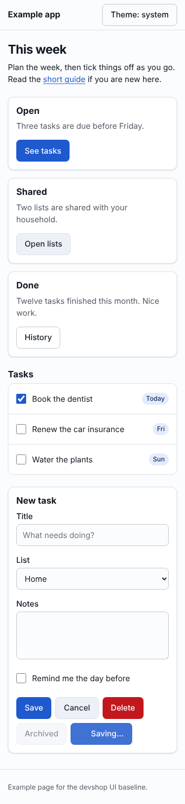
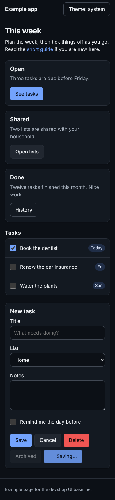
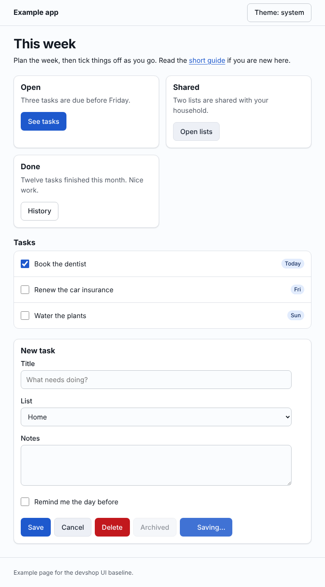
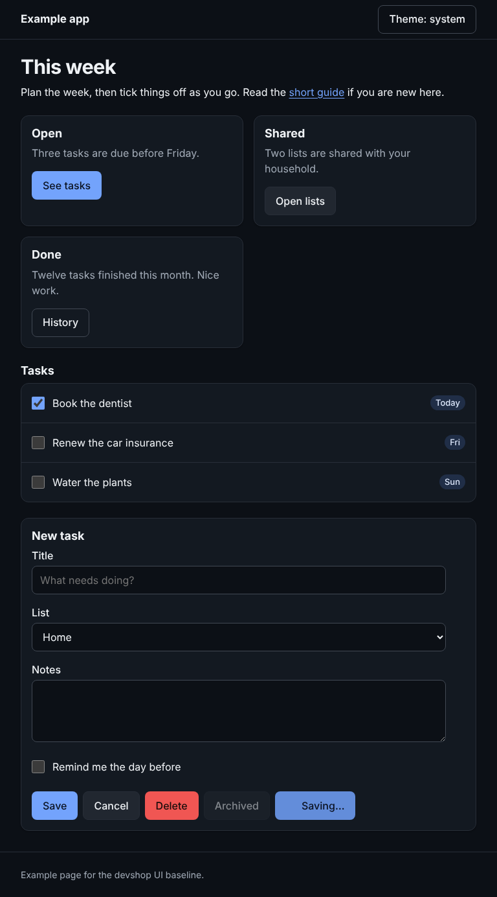
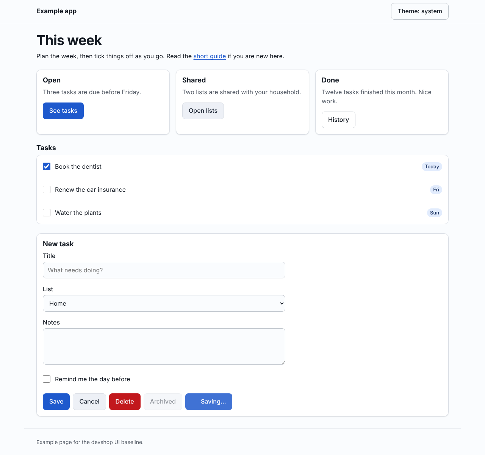
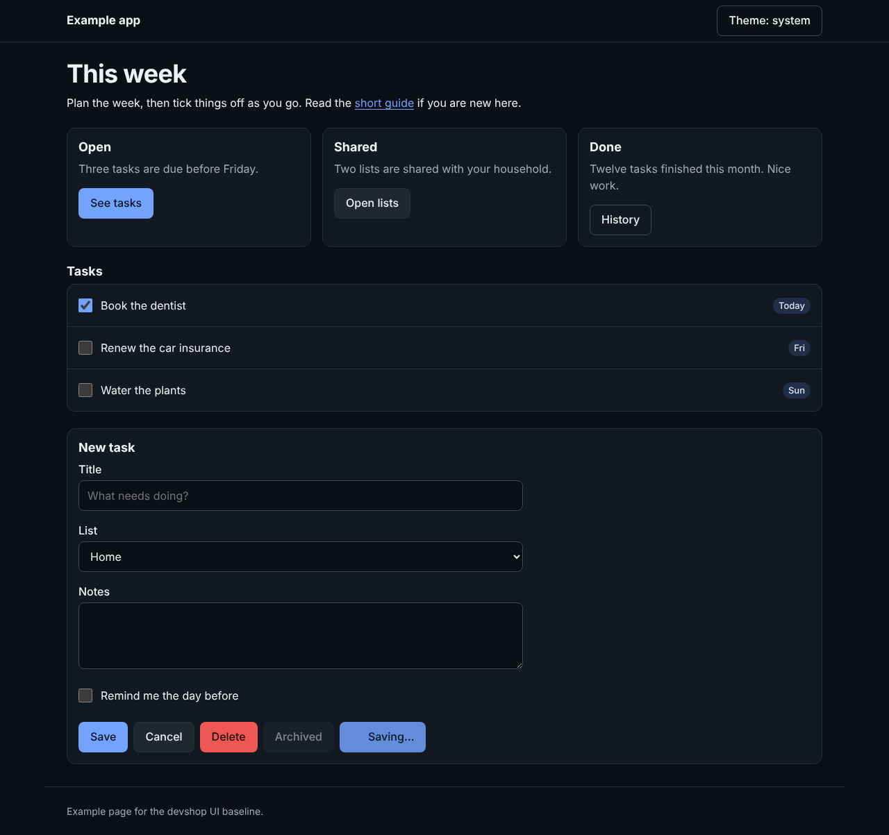

# W10.8.1 UI baseline: the example page as rendered

The six screenshots `runtime/templates/ui/render-check.mjs` wrote for
[`example.html`](../../../../../runtime/templates/ui/example.html) on the commit that added them
(spec [`ui-baseline.md`](../../../../../specs/ui-baseline.md), AC-8): 375, 768 and 1280 px, with the
system in light and in dark. They are committed so the PR can show them pinned to a commit (L-30);
uploading PR screenshots without committing them is W10.6.9.

Made with: `node runtime/templates/ui/render-check.mjs --url file://$PWD/runtime/templates/ui/example.html --out kit/notes/revamp/spikes/w10-8-ui-baseline`
(Playwright 1.56.1, Chromium build 1194; output `render-check: ok`).

| Width   | Light                            | Dark                           |
| ------- | -------------------------------- | ------------------------------ |
| 375 px  |    |    |
| 768 px  |    |    |
| 1280 px |  |  |
